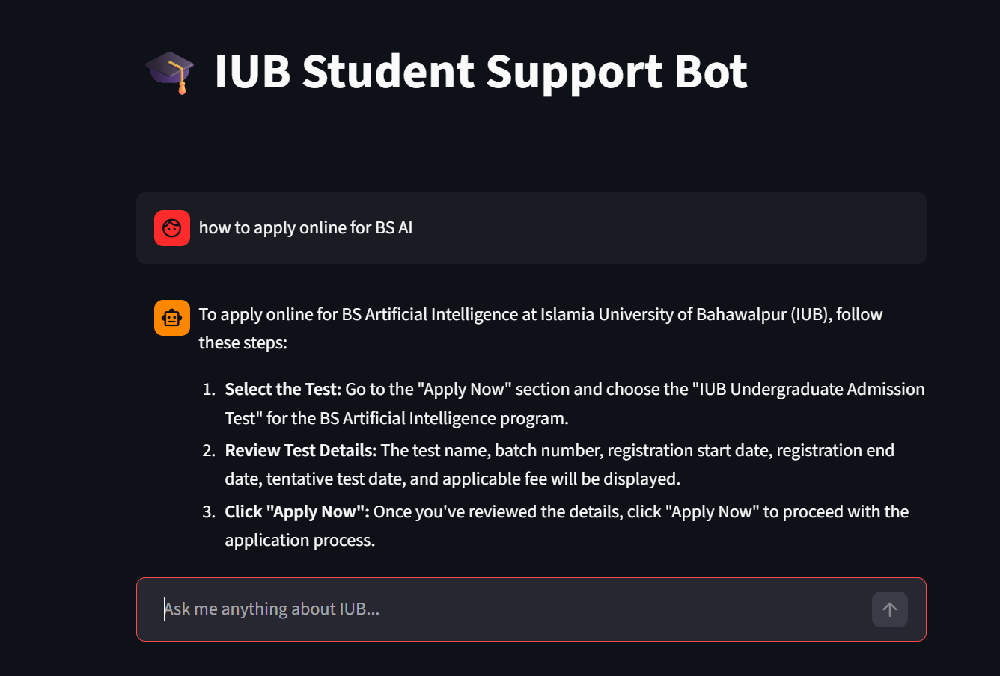
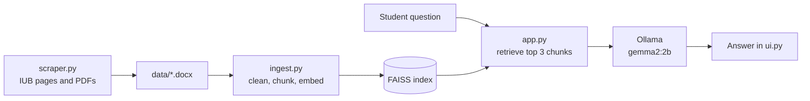

<div align="center">

# IUB Chatbot

**A fully local AI assistant that answers student questions from Islamia University of Bahawalpur's own documents.**


</div>

<!-- Add a screenshot of the chat interface here:  -->

## Overview

Students often struggle to find simple information such as admission requirements, fee details or department rules, because it is spread across websites and PDF notices. IUB Chatbot collects those documents and lets students ask questions in plain language.

It is built as a **Retrieval-Augmented Generation (RAG)** system: for each question, the bot first finds the most relevant passages in the university documents, then a local language model writes an answer using only those passages. Everything runs on your own machine, with no cloud API and no data leaving your computer.

## Features

- **Fully local**: embeddings, vector search and the language model all run offline through Ollama.
- **Grounded answers**: the model is instructed to answer only from the retrieved documents and to say "I don't know" otherwise.
- **Multilingual embeddings**: uses `multilingual-e5-base`, so the retriever is not limited to English.
- **Own data pipeline**: a scraper collects IUB pages and PDFs, and an ingestion script turns them into a searchable index.
- **Measured quality**: a reproducible evaluation suite scores both retrieval and answers (see [Evaluation](#evaluation)).

## Architecture



| Component | Choice |
|-----------|--------|
| Text splitting | `RecursiveCharacterTextSplitter`, 1000 characters, 200 overlap |
| Embeddings | `intfloat/multilingual-e5-base` (Hugging Face) |
| Vector store | FAISS, top 3 chunks per question |
| LLM | `gemma2:2b` through Ollama, temperature 0.1 |
| Framework | LangChain retrieval chain |

## Getting started

### Prerequisites

- Python 3.10 or newer
- [Ollama](https://ollama.com) installed and running

### Installation

```bash
git clone <your-repo-url>
cd IUB_Chatbot

python -m venv venv
venv\Scripts\activate          # Windows
# source venv/bin/activate     # macOS / Linux

pip install -r requirements.txt
ollama pull gemma2:2b
```

Optionally, add a Hugging Face token to a `.env` file: `HF_TOKEN=your_token`.

### Build the knowledge base

Put your `.docx` source files in `data/`, then build the vector index:

```bash
python ingest.py
```

### Run the chatbot

```bash
streamlit run ui.py
```

## Evaluation

A RAG system can fail in two places: it may not **find** the right passage, or it may find it and still **answer** badly. The chatbot is evaluated on both.

### Test set

`test_set.json` contains 32 questions generated automatically from the indexed documents by `generate_test_set.py`:

- **20 answerable questions**, each tied to a source file, an evidence phrase and the key facts a correct answer must contain.
- **12 unanswerable questions** (other universities, general knowledge, unrelated requests, some in Roman Urdu). The correct behavior is to say "I don't know".

### Metrics

| Metric | Meaning |
|--------|---------|
| hit@k | Share of questions where the correct chunk is in the top k results |
| MRR | Average rank quality of the correct chunk (1.0 = always first) |
| Keyword recall | Share of required key facts that appear in the answer |
| Full keyword match | Share of answers containing all required key facts |
| False refusal rate | How often the bot says "I don't know" when the answer exists |
| Correct refusal rate | How often the bot says "I don't know" on out-of-scope questions |

### Results (baseline)


**Retrieval**

| hit@1 | hit@3 | hit@5 | MRR |
|:-----:|:-----:|:-----:|:---:|
| 70.0% | 90.0% | 95.0% | 0.81 |

**Answer quality** (`gemma2:2b`, top 3 chunks)

| Keyword recall | Full keyword match | False refusals | Correct refusals | Avg. latency |
|:--------------:|:------------------:|:--------------:|:----------------:|:------------:|
| 81.7% | 60.0% | 0.0% | 58.3% | 19.6 s |

### Key findings

- **Retrieval works well.** For 9 out of 10 questions the correct passage is among the 3 chunks given to the model.
- **The main weakness is refusing out-of-scope questions.** 5 of the 12 got an answer instead of "I don't know", which is risky when the topic is fees or deadlines.
- **Responses are slow** (about 20 seconds) on local hardware.

### Run the evaluation

```bash
python generate_test_set.py            # build test_set.json from your index
python evaluate.py --retrieval-only    # retrieval metrics only (fast)
python evaluate.py                     # retrieval + answer quality
python evaluate.py --model <name>      # compare another Ollama model
```

Detailed per-question results are saved to `eval_results_details.csv`.

### Limitations

- The test set is small, so each question shifts the percentages by about 5 points.
- Test questions are generated from the indexed chunks, so they share wording with the documents. Real student questions will probably score lower on retrieval.
- Full keyword match is strict, so a correct answer written differently (for example `45000` vs `45,000`) counts as a miss.

## Roadmap

- [ ] Add E5 `query:` / `passage:` prefixes and re-index, then compare against the baseline
- [ ] Stricter prompt plus a retrieval-score cutoff to refuse out-of-scope questions
- [ ] Compare larger models (`llama3:8b`, `qwen2.5:7b`) and the fine-tuned model
- [ ] Grow the test set with real student questions
- [ ] Reduce latency with streaming and shorter answers

## Project structure

```
IUB_Chatbot/
├── app.py                 # RAG chain: retriever, prompt and LLM
├── ui.py                  # chat interface
├── ingest.py              # builds the FAISS index from data/
├── scraper.py             # collects source documents
├── evaluate.py            # retrieval and answer evaluation
├── generate_test_set.py   # builds test_set.json from the index
├── generate_dataset.py    # dataset generation for fine-tuning experiments
├── Modelfile              # Ollama definition for the fine-tuned GGUF model
├── data/                  # .docx source documents
├── faiss_index/           # vector database
└── requirements.txt
```

## Troubleshooting

**`huggingface-hub>=1.5.0,<2.0 is required`**: a version conflict between packages. Fix it with:

```bash
pip install "huggingface-hub>=1.5.0,<2.0"
```

**`Vector database not found at faiss_index`**: run `python ingest.py` first.

## Acknowledgements

Built with [LangChain](https://www.langchain.com), [FAISS](https://github.com/facebookresearch/faiss), [Ollama](https://ollama.com) and [Hugging Face](https://huggingface.co).
